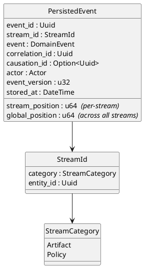
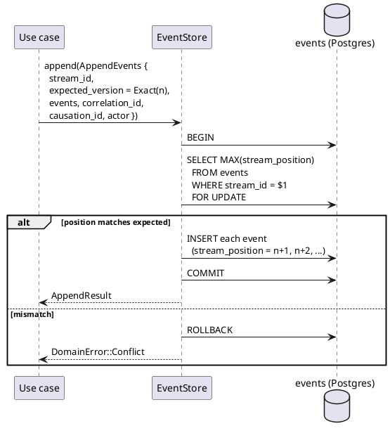
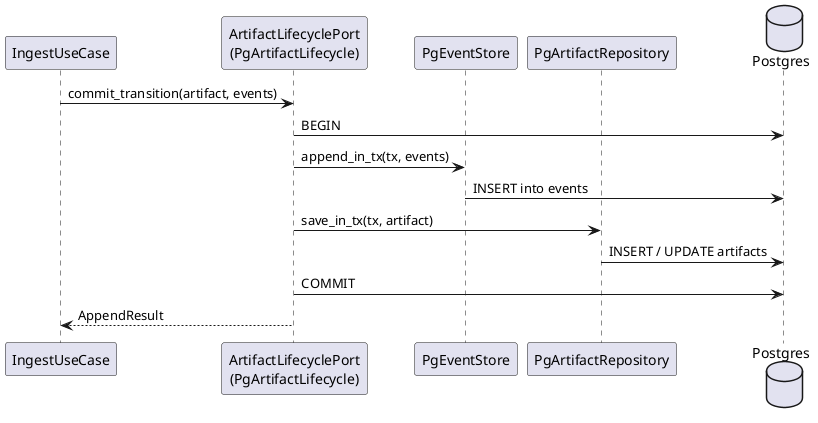
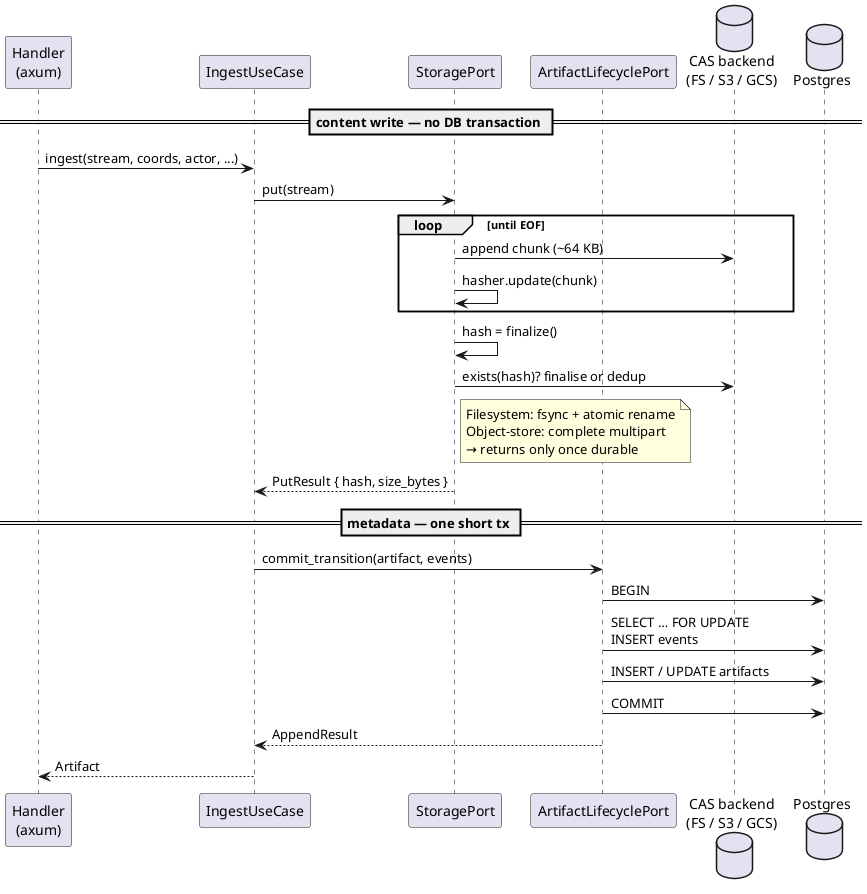
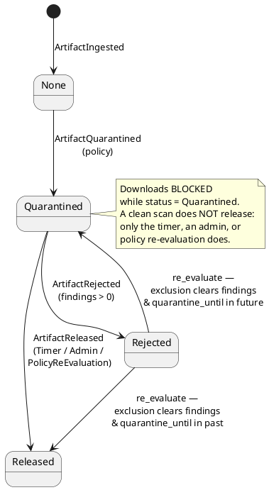
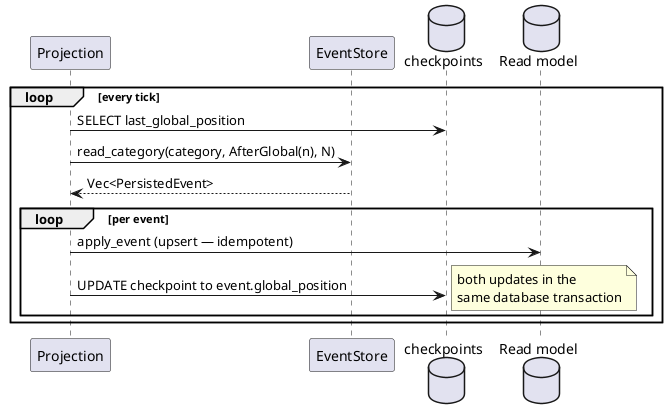

# Event Sourcing

The artifact lifecycle is driven by domain events. Mutable rows in the
`artifacts` table are a *projection* of those events, not the source of
truth.

## Streams

Each aggregate instance gets its own stream, identified by
`(StreamCategory, entity_id)`:

- `artifact-{uuid}` — one stream per artifact.
- `policy-{uuid}` — one stream per policy.



Two positions coexist: **stream position** is unique within a stream and
drives optimistic concurrency; **global position** is monotonic across
all streams and drives category-wide projections.

The two carry different guarantees, and anything that walks the log with
a cursor has to know which. Stream position is **gapless** within its
stream — derived as the stream's tail plus one inside the appending
transaction, with a unique index on `(stream_id, stream_position)`
holding it there. Global position is monotonic *in assignment* and is
neither gapless nor a completeness guarantee: it comes from a sequence,
so a rolled-back append burns its number, and the number is drawn at
INSERT while the row becomes visible at COMMIT — so a transaction can
commit *below* a cursor that has already passed, and a bare high-water
mark never sees it again. That is accepted behaviour
([ADR 0061](../../adr/0061-store-driven-notification-delivery.md)); the
detectors are on
[the event-notifications page](event-notifications.md#detecting-a-late-commit-skip).

## Appending events

`EventStore::append` takes an `AppendEvents` batch with an
`ExpectedVersion`:

| `ExpectedVersion` | Meaning | Used for |
|---|---|---|
| `NoStream` | Stream must not exist yet | `ArtifactIngested`, `PolicyCreated` |
| `Exact(n)` | Current stream position must equal `n` | All subsequent lifecycle events |
| `Any` | No concurrency check | Streams with no cross-writer race — ref moves, purge, retention sweeps, gitops CRUD-kind applies, auth events, download audit |

`Any` is **forbidden for artifact and policy lifecycle events.** The
application layer tests this invariant explicitly.



The `events` table is append-only. An immutability trigger — owned by a
separate admin role — rejects `UPDATE` and `DELETE`. `PgEventStore::new`
refuses to start if the trigger is missing or disabled.

## Dual write: events and artifact state, atomically

Use cases that change lifecycle state need both:

- append events to the `artifact-{id}` stream, and
- update the `artifacts` row (so existing read paths still work).

The naive approach of two separate writes creates a divergence window.
`ArtifactLifecyclePort::commit_transition` takes both in a single
transaction:



The inherent `_in_tx` methods live on the concrete `Pg*` types so that
the domain-layer traits stay free of `UnitOfWork` / `Transaction` noise.

### Locks and timing

The transaction is short by design. The wire sequence is:

```
BEGIN
SELECT COALESCE(MAX(stream_position), -1) FROM events
  WHERE stream_id = $1 FOR UPDATE
INSERT INTO events (...)           -- one row per event
INSERT/UPDATE artifacts (...)
COMMIT
```

- The `FOR UPDATE` takes row-level locks on existing rows of the
  stream, serialising concurrent appends to the **same artifact**.
  Different artifacts never contend — locks are per-stream.
- For the very first event (ingest), no rows exist yet and no rows are
  locked. Concurrency is instead enforced by the
  `(stream_id, stream_position)` unique index: two racers both attempt
  position 0, one wins, the loser rolls back with a unique-violation.
- The `artifacts` INSERT/UPDATE takes a row lock on that row, held
  until `COMMIT`. Lock-acquisition order is consistent across all
  callers (events first, then artifacts), so this path cannot deadlock
  with itself.
- Locks are held for the full tx. Any I/O added between
  `append_in_tx` and `commit` extends the contention window —
  keeping the use case free of other I/O inside `commit_transition` is
  load-bearing, not cosmetic.

### The same shape for CRUD rows that carry an audit trail

Permission grants, claim mappings and OIDC issuers are **not**
event-sourced — the rows are the source of truth and the events are
their audit trail (ADR 0012, ADR 0018). That makes the divergence
window worse, not better. An event-sourced aggregate whose projection
write fails can be rebuilt from its stream; a CRUD row whose *audit*
append fails is live and unattested, and the gitops apply cannot repair
it on retry: the next apply derives its events from the prior rows,
which already hold the change, so it emits nothing. The claim-mapping
branch had this written in its own comment, as expected behaviour, long
before it was a guarantee anywhere.

`AuthorityLifecyclePort` (`PgAuthorityLifecycle`) is the same
`PgUnitOfWork` shape applied there. One call takes the desired rows and
the audit batches the apply's prior-vs-desired diff produced, and
commits both or neither:

```
BEGIN
DELETE FROM permission_grants WHERE managed_by = 'gitops'
INSERT INTO permission_grants (...)   -- one row per desired grant
INSERT INTO events (...)              -- the authorization-stream batch
INSERT INTO events (...)              -- one batch per repository stream
COMMIT
```

Two details differ from the artifact case:

- **Rows first, then the appends.** The failure this closes is an
  append that fails after the row is durable, so the rows are written
  first and a failing append has real DML to roll back. There is no
  deadlock cost: the `events`-first lifecycle adapters never touch
  these five tables, and gitops apply is single-flight per boot lock.
- **The batch list is plural.** A grant reconcile routes each row's
  event to its repository stream or to the global authorization stream,
  so one reconcile spans several streams; an upstream-mapping apply is
  repo-scoped on every row, so it spans one stream per repository it
  touches. They are appended with several `append_in_tx` calls on the
  *same* unit of work, which is what makes the whole list atomic —
  previously one `EventStore::append` transaction per stream could
  leave some repository streams audited and others not.

The port covers **every** authority write: permission grants, claim
mappings and OIDC issuers, plus the gitops-managed
`repository_upstream_mappings` set (the upstream a proxy repository
trusts, with its credential reference and TLS material) and the
`service_accounts` aggregate (whose `federated_identities[].claims`
decide which JWTs may assume the account). And the five repository
ports no longer carry the write method the port replaced, so the
dual-write shape is a compile error rather than a review rule — the
same posture the `pub(crate)` `AppContext` fields take against a format
crate. The one exception is deliberate:
`RepositoryUpstreamMappingRepository` keeps its non-gitops `upsert` /
`delete` pair, the `managed_by = 'local'` admin CRUD surface, which
carries no digest, no provenance and no audit event.

Operator-visible consequence: an event-store failure during any of
those five applies now leaves the rows **unchanged**. The apply fails
closed instead of half-done.

One write stays outside the transaction, and has to: the backing
`users` row for a declared `ServiceAccount`. The FK from
`service_accounts.backing_user_id` means it must be durable before the
SA row can reference it. It is safe because an orphan backing user
confers nothing — the grant reconcile materialises
`GrantSubject::User(backing_user_id)` rows only for service accounts
resolved from the *persisted* SA aggregate, so a users row whose SA
commit rolled back carries no grant and no token. The next apply finds
it by username, reuses its id, and re-emits the same
`ServiceAccountCreated`.

## Content write precedes the metadata transaction

The artifact body is many megabytes and streams through many chunks;
the event + artifact row are a handful of columns. Running them in the
same transaction would mean holding DB locks and a connection for the
duration of the upload. Instead, the two are explicitly separated:
`StoragePort::put` runs first and returns once the content is durably
in CAS; `commit_transition` then runs a short tx that carries only
the metadata.



Three consequences worth naming:

- **The event carries a hash of bytes that already exist.** By the
  time `ArtifactIngested` lands in the `events` table, CAS already
  holds the object addressed by `sha256`. Event replay never needs to
  reach the storage backend.
- **If the transaction rolls back, content stays behind as an orphan.**
  No event and no `artifacts` row references it, but the bytes are
  still addressable by their hash. A retry with the same body hits the
  dedup check inside `put` and reuses the existing object, so retries
  are cheap and safe. Orphan reclamation is GC's job — not yet
  implemented, and CAS dedup remains correct without it.
- **If storage fails, the transaction never starts.** `put` returns
  an error, the use case propagates it, and no event is written. The
  event store never sees a half-ingested artifact.

Download mirrors this. `ArtifactUseCase::download` reads one
`artifacts` row, then opens a stream via `storage.get(&hash)`. The
body flows straight from CAS to the client — no transaction spans the
transfer, and the only DB touch is the metadata lookup.

## Artifact lifecycle state machine



These transitions are enforced on the `Artifact` entity (`quarantine`,
`reject_from_scan`, `release`, `re_evaluate`). The entity returns the
corresponding event; the use case passes both to
`commit_transition`.

## Projections

Projections are read models rebuilt by polling `read_category`:

- **Quarantine projection** consumes `ArtifactQuarantined`,
  `ArtifactReleased`, `ArtifactRejected` → updates columns on
  `artifacts`.
- **Audit log projection** consumes everything → writes the audit log.



Projections must be idempotent — after a restart the same event may be
replayed. Checkpoint advances and read-model updates commit together so
no window can leave them out of sync.

## Policy streams — three patterns

The artifact-projection model above is asynchronous: a polling loop
catches the read model up to the stream. The `policy-{uuid}` streams
follow a different shape because the only writer is `PolicyUseCase`
and the only reader is the gitops apply path. Three patterns are
worth naming.

### Synchronous-projection-write

`PolicyUseCase` appends an event and, on `Ok(_)`, immediately upserts
the corresponding row in `policy_projections` from inside the same use
case call. The two writes are NOT in one transaction, and cannot be:
`PolicyProjectionRepository` is backend-agnostic (ADR 0004), takes no
transaction handle, and its Postgres implementation holds its own
pool. The event append commits first, then the projection upsert runs.
If the upsert fails after the append succeeded, the row is one version
behind its stream. The alternative (an async projector polling
`read_category` like the artifact projection) was rejected because the
gitops apply path needs the projection up-to-date the instant the next
stream applies, and no production caller other than the apply pipeline
reads the projection at all. `PolicyUseCase` is the canonical
implementation of this pattern.

### Optimistic concurrency for gitops applies, and the repair behind it

Each `ApplyEventSourcedKind::diff` call computes events against a
snapshot of the projection; the subsequent `EventStore::append` uses
`ExpectedVersion::Exact(stream_version)` taken from that snapshot. A
mismatch surfaces as `DomainError::Conflict`, which
`ApplyConfigUseCase` translates into `ConcurrentModification` and
aborts the strict-atomic boot. Under the gitops-only stance there is
no imperative HTTP API to race against, so the conflict sources are
multi-replica boot races (two hort-server pods applying the same
`$HORT_CONFIG_DIR` simultaneously), stale in-memory projection caches
in long-lived processes that re-read after a restart elsewhere — and
the one the synchronous-projection-write pattern above produces by
itself: a **row that fell behind its own stream**.

That last one used to be terminal rather than transient. The expected
version comes *from the projection*, so a row one version behind asked
with a version the stream had already passed, got `Conflict`, and
returned before reaching the `upsert` that would have corrected it.
Every later mutation of that policy failed the same way, and since the
apply is strict-atomic, one failed projection write stopped every
subsequent apply of the whole bundle.

The reaction is now ADR 0060's read-decide-append contract. On
`Conflict` the mutation re-reads the stream, **re-derives the
projection from it** — `fold_scan_policy` for scan policies,
`RetentionPolicy::project` for retention ones — re-decides its intent
against that state, and appends once more. A projection contradicting
its stream is simply wrong, so the re-base never asks *why* they
disagreed; a failed upsert and a concurrent writer leave the same
evidence and want the same answer. A `Conflict` that survives the
re-base is the genuine concurrent writer, reported as such and
surfaced as `DomainError::Contended` (503 + `Retry-After` at an HTTP
edge, `ConcurrentModification` at the apply boundary).

It is fail-closed: a stream that cannot be read, or that the fold
refuses, rewrites nothing and the call is refused. A policy whose
`PolicyCreated` snapshot predates a config field is exactly that case
— the refusal names the missing key rather than healing the row to a
default nobody declared.

`create_policy` is outside this, by construction: it appends with
`ExpectedVersion::NoStream` against a `policy_id` minted one statement
earlier, so a `Conflict` there is a stream-identity collision and
there is no projection version to re-base onto.

### Projection-as-O(1)-cache

`find_policy_by_name` and `list_exclusions_for_policy` read the
`policy_projections` table directly — they never replay the stream.
The projection is treated as authoritative for reads precisely
because the synchronous-write pattern keeps it tight to the stream,
and because the next *write* re-derives it from the stream whenever
the two have drifted (above).

An operator-facing rebuild command is still deferred tooling, but the
function it would be built on is no longer missing: `fold_scan_policy`
is the whole `events -> projection` direction, and an admin route over
it is the same call the self-heal makes. What the rebuild path would
add is reaching a policy *nothing is currently writing to* — including
a stream whose projection row never landed at all, which the
name-keyed read cannot find.

The operator-facing how-to is at
[../how-to/declare-gitops-config.md](../how-to/declare-gitops-config.md).

## Security invariants worth naming

- **`ArtifactIngested` must be the first event in an artifact stream.**
  Enforced by `ExpectedVersion::NoStream`.
- **`Actor::Internal` is unforgeable from any inbound-HTTP crate.** The
  `InternalActorToken` has a `pub(crate)`-to-`hort-domain` field, and
  `Actor`, `ApiActor`, `InternalActor`, `StreamId`, `PersistedEvent` do
  not derive `Deserialize` — neither `hort-http-core` nor any
  `hort-http-<format>` crate can construct one from a request body.
- **Correlation IDs are server-generated.** Use cases call
  `Uuid::new_v4()`; client idempotency keys never enter the event log.
- **Payload size cap: 64 KB per event**, enforced by a `CHECK` on the
  `event_data` column (`migrations/004_events.sql`) and mirrored in
  `hort-adapters-postgres::event_store::MAX_EVENT_JSON_BYTES`. A separate,
  larger 1 MB cap exists on the unrelated `artifact_metadata.metadata`
  projection column (`migrations/003_artifacts_cas.sql`) — do not conflate
  the two. Per-format sanity caps below the 64 KB event-log ceiling are
  applied at the application layer — see
  [format-handlers.md](format-handlers.md).
- **Stream length cap: 200 events** (`hort_app::use_cases::STREAM_EVENT_CAP`),
  enforced on **both** sides, because the cap is what makes a single capped
  `ReadFrom::Start` read of an artifact stream equal to reading the whole
  stream. An artifact that needs more events is a bug or abuse.
  - *Writing.* `read_expected_version` reads the current stream before
    appending and refuses to derive a version for one that already exceeds
    the cap, which bounds every `ExpectedVersion::Exact` writer. An
    `ExpectedVersion::Any` append gets no version check from the adapter at
    all, so a repeatable `Any` writer on an artifact stream must refuse for
    itself — `RetentionUseCase::append_expired` (the daily expiry sweep) is
    the only one and does. The remaining `Any` appends on that category
    (`ArtifactPurged`, `ArtifactDeleted`, the CAS-corruption tombstone) are
    terminal and single-shot and deliberately do not refuse.
  - *Reading.* Every consumer that answers a question about an artifact's
    whole history — the latest `ScanCompleted` and whether an
    `ArtifactRejected` followed it, whether an `ArtifactExpired` for a policy
    is already present, whether a `ProvenanceVerified` exists, what the
    stream's terminal event is — reads through
    `hort_app::use_cases::read_artifact_stream`, which reads `cap + 1` events
    so a read returning at most `cap` has provably reached the tail, and
    refuses one that has not. It never returns the oldest prefix: over a
    prefix, a reverse scan turns "the latest X" into "the latest X among the
    oldest 200", and a superseded scan verdict would read as the current one.
    Raising the cap does not fix that; it only moves it.
  - *Consequence.* A stream that reaches the cap is frozen in both
    directions: no further event is accepted and no gate is decided from it.
    That is the intended fail-closed outcome (see
    [ADR 0007](../../adr/0007-fail-closed-quarantine-release-predicate.md)),
    not a state to engineer around.
