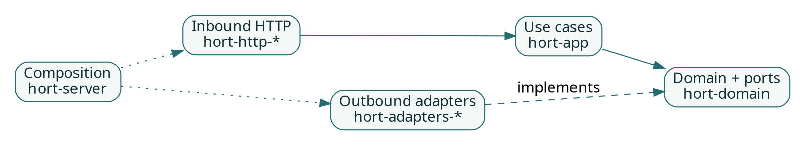

# Crate map and API boundaries

hort is a Rust workspace organized around domain behavior, application use cases, protocol handlers, adapters, and executable entry points.

## Main layers

| Layer | Example crate | Purpose |
| --- | --- | --- |
| Domain | `hort-domain` | Entities, events, and port traits; no infrastructure I/O. |
| Application | `hort-app` | Use cases and orchestration through declared ports. |
| Protocol handlers | `hort-http-oci`, `hort-http-npm`, `hort-http-pypi`, `hort-http-cargo`, `hort-http-maven` | HTTP-facing registry protocol behavior. |
| Format logic | `hort-formats` | Format-specific parsing and normalization. |
| Infrastructure | `hort-adapters-postgres`, `hort-adapters-storage`, `hort-adapters-oidc` | Implement domain ports with external systems. |
| Composition | `hort-server`, `hort-worker` | Wire infrastructure and run server/background tasks. |
| Configuration | `hort-config` | Parse and validate declared configuration. |
| CLI | `hort-cli` | Operator-facing command-line application. |

## Dependency direction

## Are these public SDKs?

**Do not infer a stable public API from a crate name.** Several crates exist to implement hort itself. Their presence in a Cargo workspace does not promise independent semantic-versioning compatibility, a plugin ABI, or dynamic runtime loading. Consult each crate's manifest and public API before adopting it as a dependency.

For changes inside the repository, see [Ports and adapters](../architecture/ports-and-adapters.md). For the up-to-date list of all workspace members, read [Cargo.toml](../../../Cargo.toml).
