# Manage declarative configuration

Use version-controlled YAML to propose, review, validate, and roll out changes to repositories, upstreams, policies, and access rules.

## Before you begin

- Identify the configuration directory configured through `HORT_CONFIG_DIR` for the target installation.
- Use the **same `hort-server` version** for validation as the version you deploy.
- Make sure the deployment can read the configuration files. Keep credentials in the supported secret mechanism rather than committing them to Git.

## Make a controlled configuration change

```graphviz
// alt: Git change passes through offline validation and human review, then deployment and server restart, followed by inspection of logs and live behavior.
// caption: Configuration is applied at server startup, not continuously reconciled.
digraph gitops_rollout {
  rankdir=LR;
  graph [bgcolor="#F4F8F7",pad="0.32",nodesep="0.42",ranksep="0.62",fontname="Inter",fontsize=13];
node [shape=box,style="rounded,filled",fillcolor="#FFFFFF",color="#246B72",penwidth=1.3,fontname="Inter",fontsize=12,fontcolor="#102D35",margin="0.18,0.12"];
edge [color="#246B72",fontname="Inter",fontcolor="#345D63",fontsize=10,arrowsize=0.7];
  git [label="Edit YAML\nin Git"];
  validate [label="Offline validation\n--strict"];
  review [label="Human review"];
  deploy [label="Deploy config files"];
  restart [label="Restart hort-server\nApply at startup",fillcolor="#DFF5EE"];
  verify [label="Check logs and\nclient behavior"];
  git -> validate -> review -> deploy -> restart -> verify;
}
```



1. Create a branch and change the required YAML resources.
2. Check the complete configuration directory, not only the edited file:

   ```bash
   HORT_CONFIG_DIR="$PWD/config" hort-server validate-config --strict
   ```

3. Review the diff and the validator output. Resolve warnings and errors according to your change policy.
4. Deploy the reviewed configuration directory to the target environment.
5. **Restart or roll out `hort-server`** to load and apply the configuration at startup.
6. Inspect startup/apply logs, then verify the *resulting behavior* with a client or an appropriately authorized operator identity.

**Important:** Editing files does not trigger live reload or continuous reconciliation. Offline validation cannot verify every database-dependent, secret-dependent, or runtime condition. A successful validator exit status is not proof that the change was applied successfully.

## What can be configured?

| Area | Supported resource kinds |
| --- | --- |
| Repositories and upstreams | `ArtifactRepository`, `UpstreamMapping` |
| Governance | `ScanPolicy`, `RetentionPolicy`, `CurationRule`, `Exclusion` |
| Identity | `OidcIssuer`, `ServiceAccount`, `ClaimMapping` |
| Permissions | `PermissionGrant`, `PermissionGrantLintConfig` |

Policies may have global or repository-specific scope. `ClaimMapping` derives hort claims from IdP groups; `PermissionGrant` is the authorization resource. Do not use the removed `Role` or `GroupMapping` resource kinds.

## When the rollout fails

1. Preserve the server startup logs and identify the resource that failed to apply.
2. Check the deployed files and secrets against the reviewed configuration; confirm the actual running server version.
3. Revert the Git change if necessary, redeploy the known-good configuration, and restart the server.
4. Verify repository access and critical client operations after rollback.

## AI-assisted operational reviews

Configuration files can be proposed or reviewed with AI tooling, validated by `hort-server`, approved by a human, and correlated with metrics after rollout. **hort does not include a built-in autonomous AI operator.** Avoid exposing secrets and sensitive operational data to external tooling; treat generated changes as untrusted until reviewed.

**Related guides:** [Identity & access](identity-access.md) · [Monitoring & troubleshooting](../operations/monitoring.md) · [Quickstart](../getting-started/quickstart.md).
