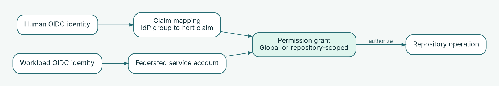

# Manage identities and permissions

Use OIDC for human sign-in and explicit grants to authorize people and workloads. Prefer repository-scoped access over global permissions.

## Choose the identity type



| Identity | Authentication | Authorization |
| --- | --- | --- |
| Human user | Enterprise OIDC provider | IdP groups mapped to hort claims; explicit permission grants |
| Automation or CI workload | Service account, optionally with federated OIDC identity | Explicit grants for the service account |

Human `ClaimMapping` rules do **not** automatically grant permissions to service accounts. The current declarative model has no `Role` or `GroupMapping` resources.

## Restrict a team to one repository

This example shows how a team claim can contribute to access. It is **not a complete identity-provider setup**: the issuer, repository, and an additional mapping supplying `team-alpha` must exist.

`config/auth/developers.yaml`:

```yaml
apiVersion: project-hort.de/v1
kind: ClaimMapping
metadata:
  name: developers
spec:
  idpGroup: hort-developers
  claim: developer
```

`config/permissions/team-write.yaml`:

```yaml
apiVersion: project-hort.de/v1
kind: PermissionGrant
metadata:
  name: team-write-pypi
spec:
  subject:
    kind: claims
    required: [developer, team-alpha]
  permission: write
  repository: pypi-alpha
```

The grant requires **both** claims and is scoped to `pypi-alpha`. A mapping for `developer` alone does not make this example operational.

## Apply and verify access changes

1. Confirm the issuer, subject, target repository, and minimum required permission.
2. Review changes to mappings and grants together. Treat an unscoped/global grant as a high-impact change.
3. Run the offline validator against the **complete** configuration directory:

   ```bash
   HORT_CONFIG_DIR="$PWD/config" hort-server validate-config --strict
   ```

4. Deploy and restart `hort-server` to apply the configuration.
5. Verify **allowed and denied** operations using test identities, rather than judging success from the YAML or validator alone.
6. Record how access will be revoked and how tokens or credentials will be rotated.

For federated CI, verify the trusted `OidcIssuer`, audience, and an identifying claim such as `sub`, `repository`, or `project_path`. Matching only `aud` or `ref` is insufficient for the documented federated-identity checks.

## Metrics access is separate

Reading `/metrics` requires a **global `read_metrics` grant** and an authorized token. Being an administrator does not automatically imply this permission. The metrics listener must also be enabled and protected; see [Monitoring & troubleshooting](../operations/monitoring.md).

## Destructive task authority is separate

Invoking an admin task that destroys something requires a **global destructive grant** in addition to `admin_task_invoke`, and being an administrator does not automatically imply it: `destroy_content` for the retention tasks (which delete artifact content) and `destroy_record` for `eventstore-archive` (which deletes the audit record itself). The two are deliberately not interchangeable — an identity trusted to reclaim storage is not thereby trusted to cut audit history. Bind such a grant to an identity (`kind: user` or `kind: serviceAccount`), not to a claim: the authority is re-checked immediately before a queued destructive job runs, and that check cannot re-derive IdP claims.

The same asymmetry decides which may be automated. A service account may hold `destroy_content`, so a scheduled retention job can run as its own identity — declare the grant, add the permission to the token's mint, and **rotate the token**, because a token's capability is frozen when it is issued and a later grant does not reach it. A service account may **not** hold `destroy_record` at all; `eventstore-archive` is run by a person holding that grant.

**Related guides:** [Declarative configuration](declarative.md) · [Server & workers](../operations/workers.md).
