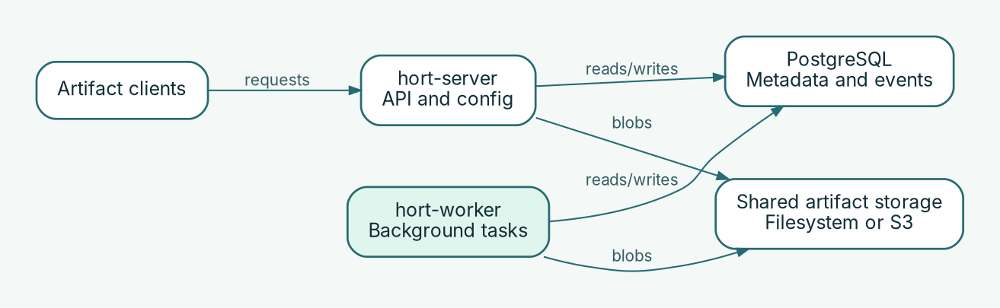

# What is hort?

hort is a self-hosted artifact repository for consuming, storing, and publishing software artifacts. It provides repository workflows across OCI/Docker, npm, PyPI, Cargo, and Maven/Gradle; operations supported by a particular client or format can differ.

## What operators manage

- **Repositories and upstreams:** local publishing and pull-through access to external package registries.
- **Artifact handling:** content-addressed storage, upstream verification, scanning, quarantine, and policy-controlled availability.
- **Identity and authorization:** OIDC authentication, service accounts, workload federation, and explicit grants.
- **Configuration:** file-based YAML desired state loaded from `HORT_CONFIG_DIR` and applied when the server starts.

## Components

| Component | Operator responsibility |
| --- | --- |
| `hort-server` | Serves repository and administration APIs, validates/applies configuration at startup. |
| `hort-worker` | Runs scanning and background tasks separately; provision its CPU and memory independently. The worker image includes external scanner binaries. |
| `hort-cli` | Operator-facing command-line tool for administration and automation. |
| PostgreSQL | Database to provision separately; the Helm chart does not install PostgreSQL. |
| Artifact storage | Filesystem/PVC for a single-replica deployment or an S3-compatible backend for multi-replica deployments. |

## Recommended first steps

1. Use [Quickstart](quickstart.md) to establish a running service and reach its health endpoints.
2. Choose [native Linux executables](../installation/native-linux.md) or [Kubernetes with Helm](../installation/kubernetes-helm.md) based on your infrastructure.
3. Follow [Declarative configuration](../configuration/declarative.md) to validate and apply a repository definition.
4. Follow a format-specific guide such as [OCI pull-through](../repositories/oci-pull-through.md) to test a package client. The pull procedure still needs real-cluster acceptance.

**Important:** A proxy repository is not equivalent to bypassing upstream rate limits. New artifacts may be quarantined and unavailable until scanning/release policy permits access.

## Monitoring and AI-assisted operations

`hort-server validate-config` can check the declarative configuration offline before a rollout. Server and worker telemetry can help operators investigate failures and capacity. These are useful inputs to AI-assisted operational workflows, **not** a claim that hort contains an autonomous AI agent. Access to metrics is protected by authorization: the server's metrics listener requires `read_metrics` permission.

