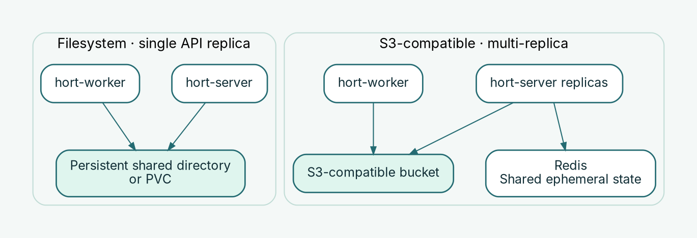

# Configure artifact storage

hort stores artifact blobs in one **deployment-wide content-addressed store (CAS)**. All repositories in an installation use the configured backend; do not put a storage path in `ArtifactRepository` YAML. Configure the backend in the **server and worker runtime environments**, or through the Helm chart. PostgreSQL remains necessary for metadata and events; the artifact store is not a replacement for PostgreSQL.

## Choose a backend



| Backend | Best fit | Operational requirement |
| --- | --- | --- |
| **Filesystem** (`filesystem`) | A native single-host deployment, or a Kubernetes installation with a single API replica | Persistent writable directory or PVC accessible to **both** `hort-server` and `hort-worker` |
| **S3-compatible** (`s3`) | Multi-replica Kubernetes or deployments requiring a shared object store | An existing bucket, network access, credentials and matching configuration for server and worker |

A filesystem backend defaults as the selected backend, **not** as a usable storage directory: you must provide `HORT_STORAGE_FILESYSTEM_PATH` when running the native binaries. For Helm, the chart supplies the filesystem path and PVC mounting. The chart requires S3 storage **and** Redis-backed ephemeral state when `replicaCount > 1`; selecting S3 by itself does not create a highly available installation.

The filesystem backend and S3 backend use the same content-addressed blob model. Repository names do not select independent folders, buckets or storage policies.

## Native Linux: filesystem

Use persistent storage with sufficient free space and a filesystem writable by the unprivileged hort services. Set the **same** storage settings in both `/etc/hort/hort-server.env` and `/etc/hort/hort-worker.env` (or your own deployment's equivalent environment files):

```ini
HORT_STORAGE_BACKEND=filesystem
HORT_STORAGE_FILESYSTEM_PATH=/var/lib/hort/cas
```

The paths above illustrate the native Ansible pattern; verify the actual `hort_systemd_cas_dir` inventory value and permissions. Server and worker must reach **the same underlying directory**, not merely identically named but unrelated filesystems. The worker writes blobs during scanning and prefetch as well as reading them. Make the directory persistent across service restarts and host upgrades, and keep it outside transient caches and `/tmp`.

The supplied native playbook provisions the storage directory and both service environments. For manual installation, follow [Install on Linux](native-linux.md) rather than adding storage variables to an incomplete standalone server command. After changing storage settings, restart **both** processes during a planned maintenance window; changing the configured root does **not** copy previously stored blobs.

## Native Linux: S3-compatible storage

Configure the same backend, bucket, endpoint, region and credentials for the server **and** worker. The following illustrates an HTTPS-compatible, path-style S3 endpoint:

```ini
HORT_STORAGE_BACKEND=s3
HORT_STORAGE_S3_BUCKET=hort-artifacts
AWS_REGION=us-east-1
AWS_ENDPOINT_URL_S3=https://s3.example.com
HORT_STORAGE_S3_FORCE_PATH_STYLE=true
AWS_ACCESS_KEY_ID=<access-key>
AWS_SECRET_ACCESS_KEY=<secret-key>
```

These are illustrative values, **not** an executable production environment file. Supply credentials through protected environment files or your secret-management system; never commit real keys to Git. Use the correct region and endpoint for your storage provider. `AWS_ENDPOINT_URL_S3` may be omitted for the standard AWS S3 endpoint in a manually configured native deployment. `AWS_DEFAULT_REGION` and `AWS_ENDPOINT_URL` are supported fallbacks, but the explicit names above are preferred.

Use HTTPS for S3 whenever possible. Plain HTTP endpoints require **`HORT_STORAGE_S3_ALLOW_HTTP=true`** and should be limited to explicitly trusted private networks; the server rejects an HTTP endpoint without this opt-in and rejects the opt-in with an HTTPS endpoint. Credentials, bucket permissions, TLS trust, bucket creation and network access are operator responsibilities. See [Trust custom CAs](custom-ca.md) for internal S3 certificates.

The `HORT_S3_SSE_MODE` / `HORT_S3_SSE_KMS_KEY_ARN` options configure **server-side PUT requests from `hort-server`**. The reviewed worker configuration does not expose equivalent SSE request options. For uniform encryption across all writers, enforce encryption at the bucket/storage-provider level and confirm it covers worker uploads; do not rely only on a server-side PUT header. The Helm equivalent settings are `storage.s3.sseMode` and `storage.s3.sseKmsKeyArn`.

## Kubernetes with Helm: filesystem PVC

For a **single API replica**, use the chart's filesystem backend and a persistent volume:

```yaml
replicaCount: 1
storage:
  backend: filesystem
  filesystem:
    pvc:
      enabled: true
      size: 50Gi
      storageClassName: ""  # Use the cluster default StorageClass
      accessMode: ReadWriteOnce
```

The chart creates a PVC and mounts it into both server and worker at `/var/lib/hort-server/cas`. The PVC has a Helm `keep` annotation: removing the chart does **not** automatically delete artifact data. **Confirm how your storage driver handles `ReadWriteOnce`**: it can constrain server and worker scheduling to a shared node and is not a multi-node storage design. A PVC is not a substitute for tested backups. Setting `storage.filesystem.pvc.enabled: false` uses transient pod storage and is unsuitable for production artifacts.

This block is an **addition** to your normal Helm values, not a complete installation. PostgreSQL, auth, NetworkPolicies and routing are covered in [Install with Helm](kubernetes-helm.md).

## Kubernetes with Helm: S3-compatible storage

Create the bucket and provide a Kubernetes Secret in the Helm release namespace with keys named `AWS_ACCESS_KEY_ID` and `AWS_SECRET_ACCESS_KEY`. For example, use a secret-manager integration or a carefully controlled provisioning workflow; do not write the values into `values.yaml`.

```yaml
replicaCount: 2
storage:
  backend: s3
  s3:
    endpoint: https://s3.example.com
    region: us-east-1
    bucket: hort-artifacts
    pathStyle: true
    allowHttp: false
    existingSecret: hort-s3-credentials
ephemeralStore:
  backend: redis
  redis:
    existingSecret: hort-redis-url
```

This is an **illustrative storage and ephemeral-state fragment**, not a complete release configuration. The Redis Secret must have the expected key as specified by the chart (`REDIS_URL` by default). An HTTPS endpoint is shown; do not set `allowHttp: true` for HTTPS. The chart requires a non-empty `storage.s3.endpoint`, `bucket` and `existingSecret`. The worker uses the **same storage Secret** as the server. Configure the remaining PostgreSQL, authentication, ingress and NetworkPolicy values before installing; network rules must allow both processes to reach the object store.

For AWS S3, supply an appropriate HTTPS S3 service endpoint when using this chart, because its schema requires an explicit endpoint. Check region, path-style behavior and IAM permissions for your bucket before deployment. For MinIO/Garage or other compatible services, use their correct service endpoint and path-style setting. If your organization requires storage encryption, configure it and verify it at the bucket/provider level, including writes initiated by the worker.

## Validate and operate the storage backend

1. **Validate configuration before rollout.** For Helm, render the full release with your actual values (`helm template ... -f values.yaml`) and review the PVC, mounts, S3 Secret references and NetworkPolicies. `hort-server validate-config --strict` validates declarative **repository/GitOps** resources, not the existence, credentials or reachability of the artifact-store backend.
2. **Check both workloads.** Confirm `hort-server` and `hort-worker` can start with the same backend and access it. Check logs for mount, permission, DNS, TLS and S3 authorization errors. A green `/healthz` alone is not a storage integration test.
3. **Exercise a real artifact operation.** Push and read back a test artifact; if scanning or prefetch is enabled, check that worker-produced data remains accessible. See [Quickstart](../getting-started/quickstart.md) and [Monitoring & troubleshooting](../operations/monitoring.md).
4. **Monitor and protect the data.** Track capacity (filesystem), bucket usage and access failures (S3), CAS integrity failures and worker errors. Restrict storage write/delete permissions and test restore procedures for **both artifact data and PostgreSQL**.

**Changing backend is a data migration, not a toggle.** Switching from filesystem to S3 (or changing bucket/root) does not migrate existing content-addressed blobs. Plan a verified copy and cutover, preserve the old store until the new store has been validated, and keep metadata, artifact bytes and retention/deletion procedures consistent. Do not run an undocumented online cutover against active writers.

For access control and recovery prerequisites, also see [Security hardening](../operations/security-hardening.md) and [Upgrade hort](upgrade.md).
