# Upgrade hort safely

Upgrade the server and workers as a coordinated change. **Read the target release's migration notes before updating binaries or images.** Database migrations are forward-only; a binary rollback does not reverse a schema change.

## Before you start

```graphviz
// alt: An operator verifies release notes and backups, pauses traffic and workloads, runs database migrations, then resumes worker and server processes and verifies the result. Database schema rollback is not automatic.
// caption: Run and verify database migrations before resuming workloads; restoring an older binary does not roll back the schema.
digraph upgrade_flow {
  rankdir=LR;
  graph [bgcolor="#F4F8F7",pad="0.32",nodesep="0.42",ranksep="0.62",fontname="Inter",fontsize=13];
node [shape=box,style="rounded,filled",fillcolor="#FFFFFF",color="#246B72",penwidth=1.3,fontname="Inter",fontsize=12,fontcolor="#102D35",margin="0.18,0.12"];
edge [color="#246B72",fontname="Inter",fontcolor="#345D63",fontsize=10,arrowsize=0.7];
  plan [label="Review release notes\nBack up data"];
  pause [label="Pause workloads\nPlan downtime"];
  migrate [label="Run and verify\nDB migrations",fillcolor="#DFF5EE"];
  resume [label="Start updated\nserver and worker"];
  check [label="Verify health\nand artifact operations"];
  plan -> pause -> migrate -> resume -> check;
}
```



1. Record the currently running server and worker versions, deployment method, and chart version (if applicable).
2. Read the changelog for **every release crossed**, especially any **Migration notice** and its minimum tolerating version.
3. Confirm a recent, restorable PostgreSQL backup, [artifact-storage recovery plan](storage.md), and access to the previous deployment artifacts.
4. Ensure new release binaries/images are accessible **without relying on the hort instance being upgraded** if that instance also serves its own images.
5. Validate the proposed YAML configuration with the target `hort-server` binary: `HORT_CONFIG_DIR=/path/to/config hort-server validate-config --strict`. This offline check is not a deployment test.

## Kubernetes with Helm

Make your namespace explicit and use the chart/version appropriate to the target release:

```bash
helm upgrade hort oci://ghcr.io/project-hort/charts/hort-server \
  --namespace hort --version <target-chart-version> -f values.yaml
kubectl -n hort get jobs
kubectl -n hort rollout status deployment/hort-hort-server
kubectl -n hort get pods
```

The chart runs schema migrations **before** upgrading application workloads. Inspect migration Job logs if the upgrade stops; do not work around migration failures with ad-hoc grants.

If a release announces a **schema contraction**, confirm the currently running version meets its **minimum tolerating version**. Otherwise first deploy an intermediate compatible version, or plan a maintenance window. Do not assume that skipping intervening versions is safe when a contraction is involved.

## Native Linux / systemd

Use the same verified release mechanism as the installation, including the native Ansible playbook when appropriate. Preserve the native service ordering: **stop dependent processes → update verified binaries/configuration → run the one-shot migration with the DDL role → start server and worker**. Adapt stop/start commands to your service units and maintenance policy:

```bash
sudo systemctl stop hort-worker hort-server
# Install verified release artifacts through your established deployment tooling.
sudo systemctl restart hort-migrate
sudo systemctl status hort-migrate --no-pager
sudo systemctl start hort-server hort-worker
sudo systemctl status hort-server hort-worker --no-pager
```

The commands above are a **sequence illustration**, not a self-contained upgrade. The Ansible-provided migration unit is `Type=oneshot` with **`RemainAfterExit=yes`**: `systemctl start hort-migrate` on an already-active unit would not rerun its migration command. Explicit **`restart`** is required when an upgrade must rerun migrations. Confirm that migration completed successfully before restarting the API server or worker. Review the installed units and inventory before applying this sequence; never use the runtime PostgreSQL role for migrations.

## Verify and recover

```bash
curl -fsS https://<your-registry-host>/healthz
curl -fsS https://<your-registry-host>/readyz
```

Also confirm worker logs, a representative authenticated pull or push, and expected metrics. For systemd use `journalctl -u hort-server` and `journalctl -u hort-worker`; on Kubernetes inspect deployment and migration Job logs.

For an application rollback, first check the current schema's `tolerates_binaries_from` status reported in the logs and the migration notice. **Do not automatically roll back to an older binary when the schema's compatibility floor excludes it.** Restore the database only via a separately tested recovery procedure, not an improvised downgrade.

See [Prepare PostgreSQL](postgresql.md), [Native Linux](native-linux.md), and [Kubernetes with Helm](kubernetes-helm.md).
