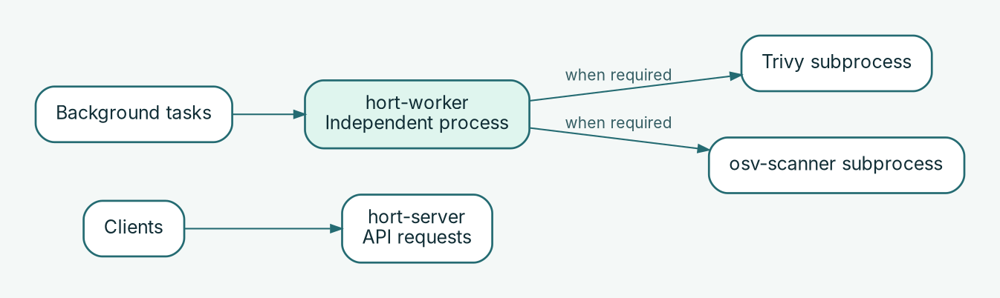

# Operate server and workers independently

hort separates request handling from background work so you can assign CPU, memory, and deployment capacity independently.

## Responsibilities

| Component | Operational responsibility |
| --- | --- |
| `hort-server` | Registry and administrative API, authentication, repository requests, configuration apply on startup |
| `hort-worker` | Background work including scanning, prefetch, and retention tasks |
| Scanner processes | Trivy and `osv-scanner` can run as subprocesses started by the worker |

On native Linux, operate server and worker as separate services. In Kubernetes, deploy and resource them as separate workloads. The **native worker executable does not bundle** Trivy or `osv-scanner`; install and configure them separately when scanning is required. The worker container image includes these tools.

## Set resource limits

1. Establish baseline CPU, memory, and storage/cache usage under representative artifact and scan load.
2. Set server and worker resource requests/limits **separately**. Leave headroom for scanner subprocesses and their peak memory usage.
3. Give the worker access to required storage, database, queue/dependency services, and permitted upstream endpoints.
4. Ensure scanner cache directories are writable and persistent where appropriate, especially for native Linux services.
5. Increase worker capacity only after examining queue backlog, job duration, failures, and dependency bottlenecks.

Separate workloads permit independent scaling, **not guaranteed automatic autoscaling or linear throughput gains**. Test the chosen replica count with your storage and queue topology.

## Verify the background processing path

1. Check that `hort-worker` is running and has loaded its configuration.
2. Trigger a permitted artifact operation that requires background work in a non-production repository.
3. Observe worker logs and job state until completion or a visible failure.
4. Confirm the client-visible result matches the configured policy; a healthy API alone does not prove scans are processing.
5. In staging, restart a worker during a job and confirm recovery or retry behavior before relying on it operationally.

For native Linux, inspect `systemctl status hort-worker` and `journalctl -u hort-worker`. For Kubernetes, use the worker workload's pod status, logs and resource usage.

**Related guides:** [Native Linux installation](../installation/native-linux.md) · [Monitoring & troubleshooting](monitoring.md) · [Scanning & governance](scanning-governance.md).
