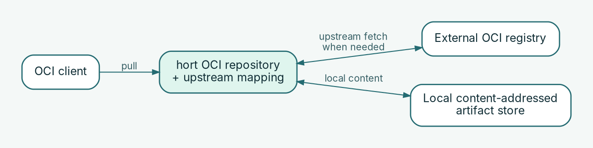

# OCI pull-through: consume upstream images through hort

**Operator goal:** Route OCI image pulls through hort, with upstream mappings
managed as declarative configuration. Requires a reachable registry endpoint,
upstream egress, a configured storage backend, and suitable permissions and
scan/quarantine policies.

## 1. Declare the repository and upstream



For OCI mirror paths, an OCI repository can be combined with explicit `UpstreamMapping` resources. Declare both the repository and the mappings in your version-controlled configuration. Choose the repository name and mapping prefixes for your installation.

For example, first declare the **hosted** OCI mirror repository. This is the
same supported layout used in the existing OCI mirror integration scenario:
a hosted OCI repository plus explicit upstream mappings. Storage is inherited
from the deployment's global CAS configuration.

```yaml
apiVersion: project-hort.de/v1
kind: ArtifactRepository
metadata:
  name: oci-mirror
spec:
  name: "OCI upstream mirror"
  format: oci
  type: hosted
  isPublic: true
  replicationPriority: local_only
```

Then add the GHCR mapping as a separate file (or YAML document). Public
access is **illustrative**; for a private mirror, set `isPublic: false` and
configure the necessary scoped grants for consuming identities.

```yaml
apiVersion: project-hort.de/v1
kind: UpstreamMapping
metadata:
  name: oci-mirror-ghcr
spec:
  repository: oci-mirror
  pathPrefix: ghcr/
  upstreamUrl: https://ghcr.io
  auth:
    type: bearer_challenge
```

This mapping references the declared `oci-mirror` repository. Ensure that
hort can reach GHCR over HTTPS and that the deployment-level storage is
available. The mapping is what selects the upstream for the `ghcr/` path;
`pathPrefix` is not a stand-alone repository or a local filesystem path.

## 2. Validate, apply and verify

```bash
HORT_CONFIG_DIR="$PWD/config" hort-server validate-config --strict
```

After code review, deploy the files and restart `hort-server`. Applying a file
is **not** a live reconciliation loop. Verify the repository using an
appropriately authorized admin request; check the repository status and server startup logs for successful application.

## 3. Pull an image with an OCI client

For a trusted HTTPS registry endpoint, a GHCR pull path could look like this:

```bash
REGISTRY_HOST=hort.example.com       # omit https://
REPO_KEY=oci-mirror
skopeo copy \
  "docker://$REGISTRY_HOST/$REPO_KEY/ghcr/oci-playground/hello-world:latest" \
  "oci-archive:./hort-ghcr-image.tar"
```

The same path can be used with another OCI client, if its authentication and
TLS trust are configured. If repository reads require authorization, log in
using the configured registry authentication mechanism first. You can define additional mappings with distinct prefixes when appropriate for your upstreams.

## 4. Verify proxy behavior

Inspect the pulled artifact, confirm the repository request in hort and repeat
the pull. With a valid `read_metrics` bearer for the **separate admin metrics
listener**, check `hort_upstream_fetch_total{result="success"}`: compare the counter before and after first and repeated pulls to understand upstream activity. No metrics access is required merely to pull an image.

Upstream rate limits still apply to requests that reach the upstream; hort can
reduce repeated requests but does not guarantee their elimination. Quarantine
or scanning may delay immediate availability.

## Troubleshooting

If pulling through the proxy fails, check the upstream mapping, the client credentials,
the upstream response, and the server logs. For runtime diagnostics, see
[Monitoring & troubleshooting](../operations/monitoring.md).
